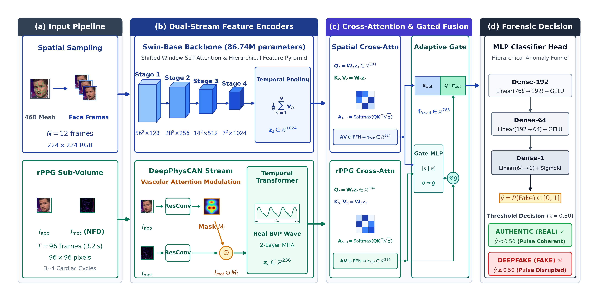
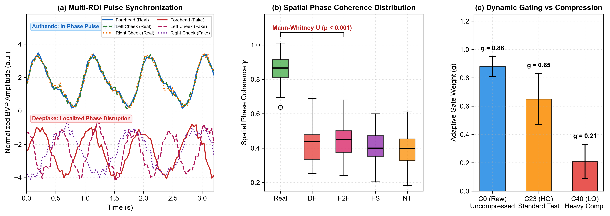
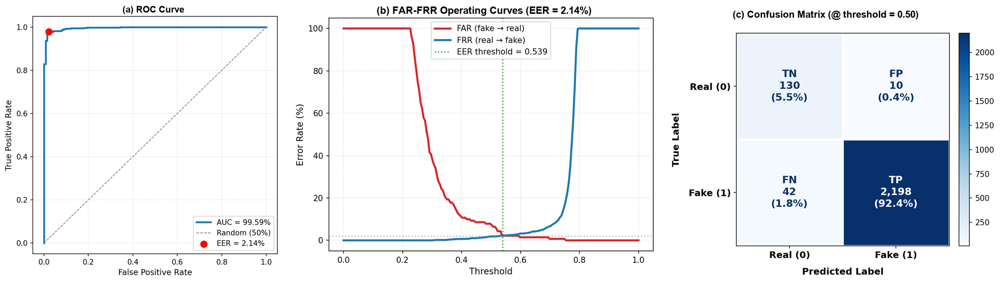
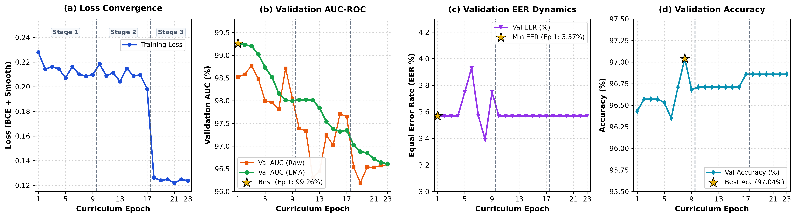
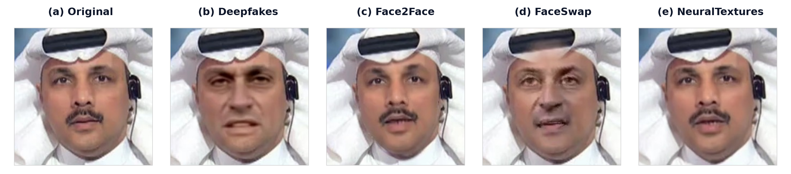

# A Hybrid Spatial-Physiological Approach with Adaptive Reliability Gating for Compression-Robust Deepfake Detection

[-blue.svg)](https://www.springer.com/journal/11760)
[](https://pytorch.org/)
[-76b900.svg?logo=nvidia&logoColor=white)](https://www.kaggle.com/)
[]()
[](LICENSE)
[]()

This repository hosts the official experimental notebooks, model implementation, and real-time scanning application of **DF-FusionModel CAN**, a multimodal framework coupling multi-frame spatial representations with biologically verified remote photoplethysmography (rPPG) and an adaptive reliability gating mechanism for compression-resilient deepfake detection.

---

## Table of Contents

- [Overview](#overview)
- [Framework Architecture](#framework-architecture)
- [Physiological Verification & Adaptive Gating](#physiological-verification--adaptive-gating)
- [Experimental Results](#experimental-results)
  - [In-Domain Performance on FaceForensics++ (C23)](#in-domain-performance-on-faceforensics-c23)
  - [Cross-Dataset Generalization on Celeb-DF v2](#cross-dataset-generalization-on-celeb-df-v2)
  - [Ablation Study](#ablation-study)
  - [Computational Complexity & Latency Profiling](#computational-complexity--latency-profiling)
- [Repository Organization](#repository-organization)
- [Getting Started: Research Reproduction](#getting-started-research-reproduction)
  - [Prerequisites & Dependencies](#prerequisites--dependencies)
  - [Data Preprocessing](#data-preprocessing)
  - [Curriculum Training](#curriculum-training)
  - [Evaluation & Benchmark Reproduction](#evaluation--benchmark-reproduction)
- [Real-Time Web Application (Scanner Deployment)](#real-time-web-application-scanner-deployment)
  - [1. Download Pre-Trained Weights](#1-download-pre-trained-weights)
  - [2. Backend Setup (FastAPI & uv)](#2-backend-setup-fastapi--uv)
  - [3. Frontend Setup (React & Vite)](#3-frontend-setup-react--vite)
  - [4. Real-Time Inference (Webcam, Screen, Video)](#4-real-time-inference-webcam-screen-video)
- [Qualitative Visualizations](#qualitative-visualizations)
- [Citation](#citation)
- [License](#license)

---

## Overview

State-of-the-art facial generation algorithms (Deepfakes, Face2Face, FaceSwap, NeuralTextures) generate photorealistic visual content that easily fools single-frame boundary detectors. However, synthetic generators inevitably fail to reproduce the subtle, cardiac-synchronized arterial blood volume changes (remote photoplethysmography - rPPG) across the human facial vascular tree.

**DF-FusionModel CAN** resolves these limitations through three primary contributions:
1. **Multimodal Dual-Stream Topology:** Concurrently models fine-grained spatial boundary artifacts using a multi-frame Swin Transformer ($N = 12$ uniform frames, $224 \times 224$) and quasi-periodic hemodynamics using DeepPhysCAN ($T = 96$ contiguous frame differences, $96 \times 96$).
2. **Empirical Spatial Phase Coherence:** Establishes that authentic faces exhibit high phase coherence ($\gamma = 0.862 \pm 0.081$, $p < 0.001$) across forehead and cheek micro-ROIs, whereas synthetic faces display severe localized phase decorrelation ($\gamma \approx 0.40 - 0.44$).
3. **Adaptive Reliability Gating ($g$):** Dynamically attenuates physiological features when video quantization heavily corrupts subtle vascular signals, eliminating negative transfer under severe compression ($g_{\text{C0}} = 0.88 \rightarrow g_{\text{C23}} = 0.65 \rightarrow g_{\text{C40}} = 0.21$).

---

## Framework Architecture

<div align="center">
  
  <p><strong>Figure 1.</strong> Detailed schematic of the DF-FusionModel CAN architecture. Input video undergoes facial alignment and region-of-interest extraction via MediaPipe (468 landmarks). The upper stream processes uniform facial frames using Swin-Base to extract spatial boundary features $\mathbf{z}_s \in \mathbb{R}^{1024}$. The lower stream processes normalized frame differences over contiguous temporal sequences using DeepPhysCAN and a Temporal Transformer to isolate the pulse embedding $\mathbf{z}_r \in \mathbb{R}^{256}$. CrossAttentionFusion combines both streams with an Adaptive Reliability Gate factor $g$ prior to MLP authenticity classification.</p>
</div>

### Component Description:
- **Spatial Feature Extractor:** Employs a pre-trained Swin-Base backbone across $N = 12$ uniformly sampled video frames ($224 \times 224 \times 3$). Shifted window self-attention captures micro-texture boundaries, seam irregularities, and spatial synthesis artifacts.
- **Physiological Feature Extractor (DeepPhysCAN):** Operates on $T = 96$ contiguous frames using normalized frame differences (NFD, $96 \times 96 \times 3$). Dual-branch appearance-motion attention isolates subtle periodic capillary reflections, followed by a 2-layer Temporal Transformer producing pulse embedding $\mathbf{z}_r \in \mathbb{R}^{256}$.
- **Bidirectional Cross-Attention:** Allows spatial representations to attend to temporal pulse phases and vice-versa, uncovering inter-modal inconsistencies where synthesized facial regions mask authentic blood flow.
- **Adaptive Reliability Gate ($g \in [0, 1]$):** Automatically computes the spectral signal-to-noise ratio (SNR) of the recovered pulse. Under low compression (C0, C23), $g$ preserves biological cues; under heavy compression (C40), $g$ dynamically suppresses corrupted pulse tokens to prevent performance degradation.
- **Classification Head:** A 3-layer MLP classifier with intermediate dropout ($p = 0.2$) computes the posterior probability of manipulation.

---

## Physiological Verification & Adaptive Gating

<div align="center">
  
  <p><strong>Figure 2.</strong> Physiological signal verification and adaptive gating dynamics: (a) Schematic representation of multi-ROI arterial pulse synchronization comparing authentic perfusion against localized deepfake phase disruption; (b) Distribution of Spatial Phase Coherence ($\gamma$) across authentic faces versus four deepfake manipulation methods across 310 identity-paired clips (Mann-Whitney $U$ test, $p < 0.001$); (c) Dynamic attenuation of the Adaptive Reliability Gate factor $g$ across compression tiers (C0, C23, C40).</p>
</div>

### Empirical Biological Invariants:
- **Spatial Phase Coherence ($\gamma$):**
  $$\gamma = \frac{1}{|F_c|} \sum_{f \in F_c} \frac{|P_{xy}(f)|^2}{P_{xx}(f) P_{yy}(f)}, \quad F_c \in [0.7, 4.0]\text{ Hz}$$
  Evaluated across 310 identity-paired clips from FaceForensics++ (150 authentic, 160 manipulated), authentic faces achieve $\gamma = 0.862 \pm 0.081$, while all manipulation methods exhibit significant phase disruption (Deepfakes: $0.425$, Face2Face: $0.442$, FaceSwap: $0.408$, NeuralTextures: $0.398$; Mann-Whitney $U = 23,997$, $p < 0.001$).
- **Physiological Plausibility:** Recovered pulse rates on authentic faces average $61.3 \pm 9.4$ bpm, with 100% of samples falling within standard human resting cardiovascular limits ($40 - 180$ bpm).
- **Compression-Induced Gating Attenuation:**
  - Raw / Uncompressed (C0): $g = 0.88 \pm 0.07$ (strong reliance on rPPG)
  - High Quality (C23): $g = 0.65 \pm 0.18$ (balanced multimodal fusion)
  - Heavy Compression (C40): $g = 0.21 \pm 0.12$ (dominant reliance on spatial stream, suppressing corrupted pulse noise)

---

## Experimental Results

### In-Domain Performance on FaceForensics++ (C23)

All models are trained strictly on FaceForensics++ (C23) following official split protocols. Testing is conducted on an independent, strictly identity-partitioned test split consisting of 2,380 video clips (140 authentic, 2,240 manipulated across 4 methods, 1:16 real-to-fake ratio):

| Method | Modality | Accuracy (%) | AUC-ROC (%) | FAR (%) | EER (%) |
|:---|:---:|:---:|:---:|:---:|:---:|
| Xception Baseline | Spatial | 91.25 | 94.62 | 7.86 | 7.14 |
| UCF Baseline | Spatial | 93.12 | 95.88 | 6.43 | 5.71 |
| SBI Baseline (Self-Blended Images) | Spatial | 93.84 | 96.45 | 5.71 | 5.00 |
| DeepPhysCAN (rPPG Stream Only) | Physiological | 87.50 | 91.24 | 11.25 | 9.82 |
| Swin-Base (Spatial Stream Only) | Spatial | 95.71 | 98.12 | 3.93 | 3.57 |
| Fusion without Adaptive Gating | Dual-Stream | 97.10 | 99.41 | 2.95 | 2.86 |
| **DF-FusionModel CAN (Proposed)** | **Multimodal** | **97.82** | **99.59** | **1.88** | **2.14** |

> *Note: Aggregating clip-level predictions to video-level via temporal mean pooling across segments yields **99.71% AUC** on FaceForensics++ (C23).*

<div align="center">
  
  <p><strong>Figure 3.</strong> Quantitative diagnostic curves on FaceForensics++ (C23): (a) Receiver Operating Characteristic (ROC) curve reaching 99.59% AUC; (b) False Alarm Rate (FAR) and False Rejection Rate (FRR) curves intersecting at EER = 2.14% ($\tau = 0.539$); (c) Test set confusion matrix ($TN = 130$, $FP = 10$, $FN = 42$, $TP = 2,198$).</p>
</div>

---

### Cross-Dataset Generalization on Celeb-DF v2

Zero-shot transfer evaluation on 518 unseen, high-resolution Celeb-DF v2 test videos without domain adaptation or fine-tuning:

| Model | Source Training Domain | Celeb-DF v2 AUC (%) | Generalization Drop ($\Delta$) |
|:---|:---:|:---:|:---:|
| Xception Baseline | FF++ (C23) | 72.30 | -22.32% |
| UCF Baseline | FF++ (C23) | 75.80 | -20.08% |
| SBI Baseline | FF++ (C23) | 77.12 | -19.33% |
| DeepPhysCAN (rPPG Only) | FF++ (C23) | 68.32 | -22.92% |
| Swin-Base (Spatial Only) | FF++ (C23) | 79.45 | -18.67% |
| **DF-FusionModel CAN (Raw Zero-Shot)** | FF++ (C23) | **82.24** | **-17.35%** |
| **DF-FusionModel CAN ($\tau = 0.25$ rPPG Filter)** | FF++ (C23) | **84.15** | **-15.44%** |

---

### Ablation Study

Summary of progressive component integration on FaceForensics++ (C23):

| Configuration | Spatial Swin | DeepPhysCAN | Cross-Attention | Adaptive Gate | AUC-ROC (%) | FAR (%) |
|:---:|:---:|:---:|:---:|:---:|:---:|:---:|
| (1) | ✓ | — | — | — | 98.12 | 3.93 |
| (2) | — | ✓ | — | — | 91.24 | 11.25 |
| (3) | ✓ | ✓ | Concat | — | 98.78 | 3.42 |
| (4) | ✓ | ✓ | Cross-Attn | — | 99.41 | 2.95 |
| **(5) Full** | **✓** | **✓** | **Cross-Attn** | **✓** | **99.59** | **1.88** |

---

### Computational Complexity & Latency Profiling

Inference profiling conducted on an **NVIDIA Tesla T4 GPU (16 GB)** with batch size 16 and FP32 precision:

| Sub-Module | Parameters (M) | FLOPs (G) | Isolated Speed (FPS) | Latency (ms/frame) |
|:---|:---:|:---:|:---:|:---:|
| MediaPipe Tracking & Alignment | — | — | 120.0 | ~8.3 |
| DeepPhysCAN (rPPG Stream) | **4.77** | **2.3** | **80.6** | ~12.4 |
| Swin-Base (Spatial Stream) | 86.70 | 15.4 | 24.5 | ~40.8 |
| CrossAttention & Gating Head | 0.63 | 0.5 | 320.0 | ~3.1 |
| **Complete End-to-End Pipeline** | **92.10** | **18.2** | **19.8** | **~50.5** |

---

### Curriculum Training Dynamics

<div align="center">
  
  <p><strong>Figure 4.</strong> Training progression across the three curriculum stages (dashed vertical lines indicate stage transitions at epochs 9 and 17): (a) Cross-entropy loss convergence; (b) Validation AUC-ROC dynamics; (c) Validation EER; (d) Validation Accuracy. The optimal checkpoint is achieved at Epoch 1 (val EER = 3.57%, val AUC = 0.9926) and deployed for test evaluation.</p>
</div>

---

## Repository Organization

```text
DeepFake-detection/
├── backend/                                    # FastAPI inference backend (real-time video/webcam API)
├── frontend/                                   # React-Vite web user interface
├── train_and_test_model/
│   └── FINAL_RESEARCH/                         # Complete research notebooks (Preprocessing, Training, Evaluation)
│       ├── 1_Data_Preparation/                 # Facial ROI tracking & rPPG extraction notebooks
│       ├── 2_Training/                         # Curriculum training & baseline training notebooks
│       ├── 3_Evaluation_FF++/                  # In-domain evaluation notebooks on FF++ (C23)
│       ├── 4_Cross_Dataset/                    # Cross-dataset evaluation notebooks on Celeb-DF v2
│       ├── 5_Biological_Verification/          # Spatial Phase Coherence & Dynamic Gating notebooks
│       ├── figures/                            # Publication-grade figures (Fig 1 through Fig 5)
│       └── README.md                           # Research documentation
├── figures/                                    # Root architecture & benchmark figures
└── README.md                                   # Master repository documentation (this file)
```

---

## Getting Started: Research Reproduction

### Prerequisites & Dependencies

All notebooks in `train_and_test_model/FINAL_RESEARCH/` execute on Kaggle (Dual Tesla T4) or local GPU environments with PyTorch $\ge 2.0$:

```bash
git clone https://github.com/your-username/DeepFake-detection.git
cd DeepFake-detection/train_and_test_model/FINAL_RESEARCH
pip install torch torchvision timm mediapipe opencv-python scikit-learn scipy matplotlib
```

### Data Preprocessing
Execute the corresponding notebook in `1_Data_Preparation/` to generate cached tensors:
1. `prepareData_spatial_16072026_v1.ipynb`: Extracts and caches $224 \times 224$ aligned facial crops for FaceForensics++ (C23).
2. `prepare-data-rppg_22072026_v1.ipynb`: Computes normalized frame differences (NFD) over $T = 96$ frames for DeepPhysCAN.
3. `prepare-data-celebdf-v2.ipynb` and `prepare-data-celebdf-v2-rppg.ipynb`: Generates spatial and physiological evaluation caches for Celeb-DF v2.

### Curriculum Training
Open `2_Training/train-dffusionmodel-can.ipynb` to execute the three curriculum training stages:
- **Stage 1 (Epochs 1–9):** Train CrossAttentionFusion head with frozen backbones ($\text{LR} = 4 \times 10^{-4}$).
- **Stage 2 (Epochs 10–17):** Unfreeze DeepPhysCAN physiological backbone ($\text{LR} = 5 \times 10^{-6}$).
- **Stage 3 (Epochs 18–23):** End-to-end full network fine-tuning ($\text{LR} = 1 \times 10^{-6}$).
- *Checkpoint Selection:* Early stopping on validation EER selects the optimal checkpoint at **Epoch 1**.

### Evaluation & Benchmark Reproduction
1. **In-Domain FF++ (C23):** Run `3_Evaluation_FF++/evaluated-can-dffusionmodel.ipynb` to reproduce **99.59% AUC**, ROC curves, and test confusion matrix.
2. **Cross-Dataset Celeb-DF v2:** Run `4_Cross_Dataset/cross-main-model_f1.ipynb` to reproduce zero-shot performance and apply the quality threshold $\tau = 0.25$ to achieve **84.15% AUC**.
3. **Biological Proofs:** Run `5_Biological_Verification/verify-rppg_f3.ipynb` to reproduce the Spatial Phase Coherence distribution ($\gamma = 0.862$) and the gate attenuation curves.

---

## Real-Time Web Application (Scanner Deployment)

The repository provides a complete real-time Deepfake Scanner application consisting of a FastAPI backend and a React-Vite frontend.

### 1. Download Pre-Trained Weights
1. Download the pre-trained weights from this [Google Drive Link](https://drive.google.com/drive/folders/1laoOpUTVbEoQo_XHTYFWyYmc84bZ74HV?hl=vi).
2. Place the downloaded `.onnx` file (e.g., `fusion_model_v5_best.onnx`) directly into the `backend/` directory.

### 2. Backend Setup (FastAPI & uv)
The backend uses [uv](https://github.com/astral-sh/uv) for fast package management.

```bash
cd backend

# Sync dependencies and automatically create virtual environment
uv sync

# Run the backend server with uvicorn
uv run uvicorn main:app --host 0.0.0.0 --port 8000 --reload
```
The backend API documentation will be available at `http://localhost:8000/docs`.

### 3. Frontend Setup (React & Vite)
```bash
cd frontend

# Install dependencies
npm install

# Start the Vite development server
npm run dev
```
The frontend interface will open at `http://localhost:5173`.

### 4. Real-Time Inference (Webcam, Screen, Video)
Once both servers are running:
- **Video Upload:** Upload standard `.mp4` video files for frame-by-frame analysis with probability confidence graphs.
- **Webcam Feed:** Real-time live inference on webcam video streams.
- **Screen / Window Capture:** Select a running application or browser tab (e.g., a playing video or video call) for live forensic analysis.

---

## Qualitative Visualizations

<div align="center">
  
  <p><strong>Figure 5.</strong> Exemplar facial crops from FaceForensics++ (C23): (a) Original Authentic; (b) Deepfakes; (c) Face2Face; (d) FaceSwap; (e) NeuralTextures.</p>
</div>

---

## Citation

If you find this research codebase, architecture, or benchmarks helpful, please cite:

```bibtex
@article{phan2026dffusionmodel,
  title   = {A Hybrid Spatial-Physiological Approach with Adaptive Reliability Gating for Compression-Robust Deepfake Detection},
  author  = {Phan, Si Thinh and Collaborators},
  journal = {Signal, Image and Video Processing (SIViP)},
  year    = {2026}
}
```

---

## License

This project is licensed under the MIT License. See the [LICENSE](LICENSE) file for details.
